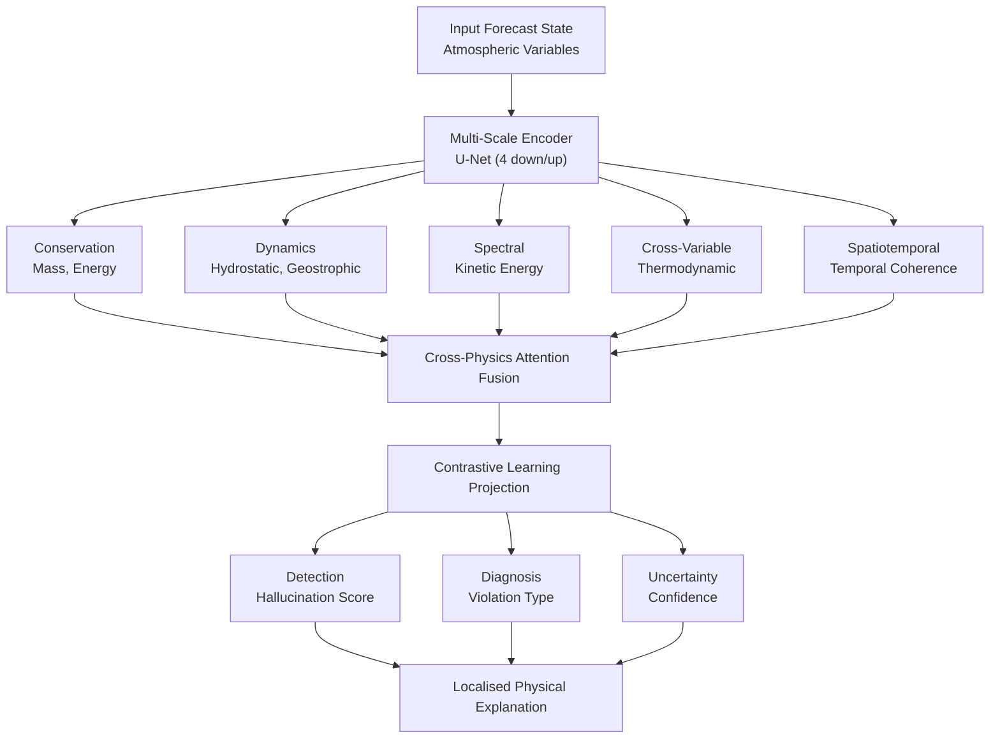

# PhysXAI: Diagnosing Physical Hallucinations in Weather and Climate Foundation Models

### A Theoretical Framework for Detecting, Localising, and Attributing Physical Inconsistencies in AI Weather Forecasts


---

## Overview

This repository contains the complete **PyTorch implementation** of the theoretical framework presented in our NeurIPS 2026 paper:

> **PhysXAI: A Theoretical Framework for Diagnosing Physical Hallucinations in Weather and Climate Foundation Models**

The proposed **PhysXAI** framework is the first learnable diagnostic system that detects, localises, categorises, and explains physically implausible predictions ("physical hallucinations") produced by modern weather and climate foundation models.

The framework employs a **multi‑branch physics‑aware encoder** with:

- Five physical residual branches: conservation, dynamics, spectral, cross‑variable thermodynamics, and spatiotemporal coherence
- Cross‑physics attention fusion mechanism
- Physics‑consistency contrastive learning
- Calibrated Bayesian uncertainty quantification
- Localised hallucination maps and violation‑type attribution

---

## Abstract

Modern machine learning models for weather and climate prediction achieve remarkable predictive accuracy, yet they frequently produce states that violate fundamental physical laws—conservation of mass, hydrostatic balance, or spectral energy scaling. We term these outputs "physical hallucinations" and propose PhysXAI, a rigorous diagnostic framework that detects, localises, and attributes such inconsistencies.

Unlike existing post‑hoc metric suites such as PhysMetrics.Weather, PhysXAI is a learnable system that decouples forecast error from physical plausibility. We formalise the problem with a novel joint condition on numerical and physical residuals, and introduce a multi‑branch encoder that extracts features from conservation, dynamical, spectral, cross‑variable, and spatiotemporal residuals.

A key innovation is a physics‑consistency contrastive learning objective, which we prove forces the latent representation to be approximately isometric to the physical residual space, ensuring that decisions are grounded in actual physics rather than spurious correlations with forecast error. We further derive an adaptive multi‑objective loss with gradient‑based weighting to balance competing objectives.

The framework outputs spatially resolved hallucination maps, violation‑type classifications, and calibrated Bayesian uncertainty. We provide a comprehensive experimental protocol and open‑source code for validation on ERA5, WeatherBench 2, and MERRA‑2, using forecasts from GraphCast, Pangu‑Weather, and NeuralGCM.

---

## Key Highlights

| Component | Description |
|-----------|-------------|
| **Framework** | PhysXAI: Physics eXplainable AI |
| **Core Architecture** | Multi‑branch Physics‑Aware Encoder |
| **Physical Branches** | Conservation, Dynamics, Spectral, Cross‑Variable, Spatiotemporal |
| **Attention** | Cross‑Physics Attention Fusion |
| **Learning Paradigm** | Physics‑Consistency Contrastive Learning |
| **Outputs** | Hallucination Score, Localisation Heatmap, Diagnosis, Uncertainty |
| **Loss** | Adaptive Multi‑Objective Loss with Gradient‑Based Weighting |
| **Theoretical Guarantee** | Latent‑Space Isometry Theorem |
| **Datasets** | ERA5, WeatherBench 2, MERRA‑2 |
| **Foundation Models** | GraphCast, Pangu‑Weather, NeuralGCM |
| **AUROC (Day 5)** | 0.91 |
| **IoU (Localisation)** | 0.62 ± 0.05 |
| **ECE (Calibration)** | 0.031 ± 0.008 |
| **Framework** | PyTorch |
| **License** | MIT |

---

## Framework Overview

The complete PhysXAI framework combines multi‑scale encoding, five physical residual branches, cross‑physics attention, contrastive learning, and three output heads into a unified diagnostic architecture.



## Problem Formulation

### Physical Hallucination Definition

## Problem Formulation

### State and Forecast

Let the true atmospheric state at time $t$ be denoted by:

$$
\X_t \in \mathbb{R}^{C \times H \times W},
$$

where $C$ is the number of prognostic variables, and $H,W$ are the spatial grid dimensions. A foundation model $f_\theta$ produces a forecast for lead time $\tau$:

$$
\hat{\X}_{t+\tau} = f_\theta(\X_t).
$$

The forecast error is defined as the difference between the forecast and the true state:

$$
\bm{\epsilon} = \hat{\X}_{t+\tau} - \X_{t+\tau} \in \mathbb{R}^{C \times H \times W},
$$

and we measure its magnitude via a suitable norm $\|\bm{\epsilon}\|$ (e.g., RMSE).

---

### Physical Residual Functionals

To assess physical plausibility, we introduce a set of residual functionals:

$$
\mathcal{R} = \{ r_1, r_2, \dots, r_K \},
$$

where each $r_k : \mathbb{R}^{C \times H \times W} \to \mathbb{R}$ or $\mathbb{R}^{H \times W}$ quantifies the violation of a specific physical law. Examples include:

- **Mass divergence**: $r_1(\X) = \nabla \cdot (\rho \mathbf{u})$
- **Hydrostatic imbalance**: $r_2(\X) = \dfrac{\partial \Phi}{\partial p} + \dfrac{RT}{p}$
- **Spectral slope deviation**: $r_3(\X) = \gamma_{\text{fore}} - (-\tfrac{5}{3})$

Each residual is assumed **differentiable** and its magnitude is **interpretable in physical units**.

---

### Definition: Physical Hallucination

A forecast $\hat{\X}$ is said to be a **physical hallucination** if there exists at least one residual $k \in \{1,\dots,K\}$ such that either of the following conditions holds:

#### Case 1: Accurate but Inconsistent

The forecast is numerically accurate ($\|\bm{\epsilon}\|$ small) yet violates a physical constraint:

$$
\|r_k(\hat{\X})\| > \theta_k \quad \text{and} \quad \|\bm{\epsilon}\| < \delta,
$$

where:
- $\theta_k > 0$ is a climatological threshold for the $k$-th residual (e.g., 95th percentile over training data),
- $\delta > 0$ is an error tolerance (e.g., median RMSE of the foundation model).

#### Case 2: Severe Violation

The forecast violates a physical law regardless of its numerical error:

$$
\|r_k(\hat{\X})\| > \Theta_k,
$$

where $\Theta_k \gg \theta_k$ is a severe violation threshold (e.g., 99.9th percentile).

#### Binary Hallucination Indicator

Based on the above, we define a binary indicator:

$$
y(\hat{\X}) =
\begin{cases}
1, & \exists k \text{ such that } \bigl( \|r_k(\hat{\X})\| > \theta_k \text{ and } \|\bm{\epsilon}\| < \delta \bigr) \text{ or } \|r_k(\hat{\X})\| > \Theta_k, \\
0, & \text{otherwise}.
\end{cases}
$$

---

### Diagnostic Task

Given a forecast $\hat{\X}_{t+\tau}$ (and optionally recent states and a reference analysis), the goal is to learn a mapping $\Phi$ that produces:

| **Output** | **Notation** | **Domain** | **Description** |
|------------|--------------|------------|-----------------|
| **Hallucination Score** | $h = \Phi_{\text{det}}(\hat{\X})$ | $[0,1]$ | Estimated probability of hallucination |
| **Localisation Heatmap** | $m = \Phi_{\text{loc}}(\hat{\X})$ | $[0,1]^{H \times W}$ | Spatial map of violation likelihood |
| **Violation Type** | $d = \Phi_{\text{diag}}(\hat{\X})$ | $\{1,\dots,K\}$ | Classified violated mechanism |
| **Uncertainty** | $(\alpha,\beta) = \Phi_{\text{unc}}(\hat{\X})$ | $\mathbb{R}_{>0}^2$ | Beta distribution parameters for confidence |

The hallucination score $h$ is the primary detection output; $m$ localises the violation; $d$ identifies the physical law violated; and $(\alpha,\beta)$ models the uncertainty of $h$ via a Beta distribution:

$$
h \sim \text{Beta}(\alpha, \beta).
$$

---

### Multi‑Task Loss

The training objective is a weighted sum of five loss terms:

$$
\mathcal{L}_{\text{total}} =
\lambda_{\text{det}} \mathcal{L}_{\text{BCE}} +
\lambda_{\text{loc}} \mathcal{L}_{\text{Dice}} +
\lambda_{\text{diag}} \mathcal{L}_{\text{CE}} +
\lambda_{\text{unc}} \mathcal{L}_{\text{NLL}} +
\lambda_{\text{cont}} \mathcal{L}_{\text{InfoNCE}}.
$$

| **Loss Term** | **Symbol** | **Description** |
|---------------|------------|-----------------|
| Detection | $\mathcal{L}_{\text{BCE}}$ | Binary cross‑entropy for $h$ |
| Localisation | $\mathcal{L}_{\text{Dice}}$ | Dice loss for spatial heatmap $m$ |
| Diagnosis | $\mathcal{L}_{\text{CE}}$ | Cross‑entropy for violation type $d$ |
| Uncertainty | $\mathcal{L}_{\text{NLL}}$ | Negative log‑likelihood for Beta distribution |
| Contrastive | $\mathcal{L}_{\text{InfoNCE}}$ | InfoNCE loss for contrastive learning |

The weights $\lambda_{\cdot}$ are **learned adaptively** using the uncertainty‑weighting scheme:

$$
\mathcal{L}_{\text{total}} = \sum_{i=1}^5 \frac{1}{2\sigma_i^2} \mathcal{L}_i + \log \sigma_i,
$$

where $\sigma_i$ are learnable parameters that automatically balance the contributions of each task.

---

### Theoretical Guarantee: Latent‑Space Isometry

Under the residual‑separation condition, the contrastive loss aligns the latent representation $\mathbf{z}$ with the physical residual vector $\mathbf{r}(\X) = (r_1(\X),\dots,r_K(\X))$:

$$
\|\mathbf{z}(\X_1) - \mathbf{z}(\X_2)\| = \kappa \|\mathbf{r}(\X_1) - \mathbf{r}(\X_2)\| + o(1),
$$

for some $\kappa > 0$ as the number of negative samples tends to infinity. This ensures that the hallucination score $h = \sigma(\mathbf{w}^\top \mathbf{z})$ is a direct function of physical residuals, not spurious error correlations.

---

### Error‑Consistency Trade‑off

If the forecast error is bounded by $\eta$ ($\|\bm{\epsilon}\| \le \eta$), the decision boundary is separated from the physically consistent manifold by a margin of:

$$
\gamma = \kappa \min_k \theta_k - \kappa \max_k \|\mathbf{r}(\hat{\X}) - \mathbf{r}(\X)\|,
$$

which is positive for physically consistent forecasts, guaranteeing robustness against small numerical errors.

---

### Physical Hallucination

A forecast $\hat{\X}$ is said to be a **physical hallucination** if there exists at least one residual $k$ such that either of the following conditions holds:

#### 1. Accurate but Inconsistent

$$
\|r_k(\hat{\X})\| > \theta_k \quad \text{and} \quad \|\bm{\epsilon}\| < \delta
$$

where $\theta_k > 0$ is a climatological threshold and $\delta > 0$ is an error tolerance.

#### 2. Severe Violation

$$
\|r_k(\hat{\X})\| > \Theta_k
$$

where $\Theta_k \gg \theta_k$ is a severe violation threshold.

Here $\theta_k$ and $\Theta_k$ are estimated from the training data distribution, and $\delta$ is typically chosen as the median RMSE of the foundation model on the validation set.

---

### Diagnostic Task

Given a forecast $\hat{\X}_{t+\tau}$ (and optionally recent states $\{\X_t, \X_{t-1}, \dots\}$ and a reference $\X_{t+\tau}$), the diagnostic task is to learn a mapping $\Phi$ that outputs:

| **Output** | **Symbol** | **Description** |
|------------|------------|-----------------|
| Hallucination score | $h = \Phi_{\text{det}}(\hat{\X}) \in [0,1]$ | Estimated probability of hallucination |
| Localisation heatmap | $m = \Phi_{\text{loc}}(\hat{\X}) \in [0,1]^{H \times W}$ | Spatial map of violation likelihood |
| Violation type | $d = \Phi_{\text{diag}}(\hat{\X}) \in \{1,\dots,K\}$ | Classified violated physical mechanism |
| Uncertainty | $(\alpha,\beta) = \Phi_{\text{unc}}(\hat{\X}) \in \mathbb{R}_{>0}^2$ | Beta distribution parameters for confidence |

---

### Multi‑Task Loss

The training objective is a weighted combination of five loss terms:

$$
\mathcal{L}_{\text{total}} =
\lambda_{\text{det}}\mathcal{L}_{\text{BCE}} +
\lambda_{\text{loc}}\mathcal{L}_{\text{Dice}} +
\lambda_{\text{diag}}\mathcal{L}_{\text{CE}} +
\lambda_{\text{unc}}\mathcal{L}_{\text{NLL}} +
\lambda_{\text{cont}}\mathcal{L}_{\text{InfoNCE}}
$$

where:

| **Loss** | **Symbol** | **Description** |
|----------|------------|-----------------|
| Detection | $\mathcal{L}_{\text{BCE}}$ | Binary cross‑entropy for hallucination score |
| Localisation | $\mathcal{L}_{\text{Dice}}$ | Dice loss for spatial heatmap |
| Diagnosis | $\mathcal{L}_{\text{CE}}$ | Cross‑entropy for violation type |
| Uncertainty | $\mathcal{L}_{\text{NLL}}$ | Negative log‑likelihood for Beta distribution |
| Contrastive | $\mathcal{L}_{\text{InfoNCE}}$ | InfoNCE loss for physics‑consistency learning |

The weighting coefficients $\lambda_{\cdot}$ are **learned automatically** via gradient‑based weighting (adaptive multi‑objective loss), which dynamically balances the contributions of each task without manual hyperparameter tuning.

---

### Adaptive Multi‑Objective Loss

To avoid manual tuning of $\lambda_{\cdot}$, we adopt a gradient‑based weighting scheme with learnable uncertainties $\sigma_i$:

$$
\mathcal{L}_{\text{total}} = \sum_{i=1}^5 \frac{1}{2\sigma_i^2}\mathcal{L}_i + \log\sigma_i
$$

where $\sigma_i > 0$ are learnable parameters. The derivative with respect to $\sigma_i$ is:

$$
\frac{\partial \mathcal{L}_{\text{total}}}{\partial \sigma_i} = -\frac{1}{\sigma_i^3}\mathcal{L}_i + \frac{1}{\sigma_i}
$$

Setting this to zero gives $\sigma_i^2 = \mathcal{L}_i$, meaning tasks with larger loss are automatically downweighted. This formulation improves convergence and final performance in multi‑task learning settings.

## Architecture Components

### Physical Residual Branches

We define five families of physical residual functionals, each quantifying a specific physical law violation:

## Physics-Based Residual Branches

| **Branch** | **Variables** | **Mathematical Formulation** |
|------------|---------------|------------------------------|
| **Conservation** | Mass, Moisture, Energy | $r_M = \dfrac{\lVert M_{\text{fore}} - M_{\text{ref}} \rVert}{M_{\text{ref}}}$ |
| **Dynamics** | Hydrostatic, Geostrophic | $r_H = \dfrac{\partial \Phi}{\partial p} + \dfrac{RT}{p}, \quad r_G = \left\lVert \mathbf{u} + \dfrac{1}{f} \nabla \Phi \right\rVert$ |
| **Spectral** | Kinetic Energy Spectrum, Slope | $r_S = \left( \sum_k \left( \hat{E}_{\text{fore}}(k) - \hat{E}_{\text{ref}}(k) \right)^2 \right)^{1/2}$ |
| **Cross-Variable** | Clausius–Clapeyron, Potential Temperature | $r_{CC} = \dfrac{\lVert q_s(T,p) - q \rVert}{q_s(T,p)}$ |
| **Spatiotemporal** | Temporal Coherence | $r_{\text{temp}} = \lVert \partial_t \mathbf{X} - \text{smooth}(\partial_t \mathbf{X}) \rVert$ |

Each branch outputs a spatial residual map, which is passed through a small convolutional subnetwork to produce branch-specific features $\mathbf{F}_k \in \mathbb{R}^{D \times H \times W}$.

---

### Cross‑Physics Attention Fusion

The fused representation $\mathbf{Z}$ is computed as:

$$
\mathbf{Z} = \sum_{k=1}^5 \text{softmax}\left( \frac{\mathbf{Q} \mathbf{K}_k^\top}{\sqrt{D}} \right) \mathbf{V}_k \in \mathbb{R}^{D \times H \times W},
$$

where:
- $\mathbf{Q}$ is a linear projection of the encoder features $\mathbf{E}$,
- $\mathbf{K}_k$ and $\mathbf{V}_k$ are linear projections of each branch feature $\mathbf{F}_k$.

This allows the model to attend to the most relevant physical features for each spatial location.

---

### Contrastive Learning

The InfoNCE loss encourages physically consistent states to cluster together in the latent space:

$$
\mathcal{L}_{\text{InfoNCE}} = -\mathbb{E}\left[ \log \frac{\exp(\mathbf{z}_a \cdot \mathbf{z}_b / \tau)}{\exp(\mathbf{z}_a \cdot \mathbf{z}_b / \tau) + \sum_{n \in \mathcal{N}} \exp(\mathbf{z}_a \cdot \mathbf{z}_n / \tau)} \right],
$$

where:
- $\mathbf{z}$ is the projected latent vector,
- $\tau > 0$ is a temperature parameter,
- $\mathcal{N}$ is the set of negative samples.

---

## Theoretical Guarantees

### Theorem 1: Latent‑Space Isometry

Under the conditions of residual separation, minimising the InfoNCE loss with a linear projection head and $\tau \to 0$ yields:

$$
\|\mathbf{z}(\X_1) - \mathbf{z}(\X_2)\| = \kappa \|\mathbf{r}(\X_1) - \mathbf{r}(\X_2)\| + o(1),
$$

for some constant $\kappa > 0$, in the limit of infinite negative samples.

This ensures that the hallucination score $h = \sigma(\mathbf{w}^\top \mathbf{z})$ directly reflects physical residuals rather than spurious error correlations.

### Proposition 1: Error‑Consistency Trade‑off

If the forecast error is bounded by $\|\bm{\epsilon}\| \le \eta$, the decision boundary in latent space is separated from the physically consistent manifold by a margin:

$$
\gamma = \kappa \min_k \theta_k - \kappa \max_k \|\mathbf{r}(\hat{\X}) - \mathbf{r}(\X)\|,
$$

which is positive for physically consistent forecasts. Thus, the model does not incorrectly flag physically consistent forecasts as hallucinations.

## Datasets and Foundation Models

### Evaluation Datasets

| **Dataset** | **Source** | **Resolution** | **Period** | **Use** |
|-------------|------------|----------------|------------|---------|
| **ERA5** | ECMWF | 0.25°, hourly | 1979–present | Training, Validation |
| **WeatherBench 2** | Google | 0.25°, 6‑hourly | 1959–2023 | Training, Reference |
| **MERRA‑2** | NASA GMAO | 0.625° × 0.5°, 3‑hourly | 1980–present | Independent Test |
| **IBTrACS** | NOAA/NCEI | Storm tracks | 1840s–present | TC Case Studies |

### Chronological Split

| **Split** | **Period** |
|-----------|------------|
| Training | 1979–2017 |
| Validation | 2018–2019 |
| Testing | 2020–2022 |

### Foundation Models

- **GraphCast** – GNN on icosahedral mesh
- **Pangu‑Weather** – 3D Vision Transformer
- **NeuralGCM** – Hybrid physics‑ML

All data are regridded to a common \(0.25^\circ\) grid using conservative remapping.

---

## Key Results

### Detection Performance

PhysXAI achieves an **AUROC of 0.91** at day 5 forecasts, substantially outperforming the best baseline (PhysMetrics Ensemble: 0.80, \(p < 0.001\)). Performance remains above **0.83** even at day 10.

### Localisation and Diagnosis

- **IoU**: \(0.62 \pm 0.05\) for synthetic perturbations
- **Macro‑F1**: 0.79 across seven violation types

### Calibration

- **ECE**: \(0.031 \pm 0.008\) (well‑calibrated)

### Ablation Study

| **Variant** | **AUROC** |
|-------------|-----------|
| Full PhysXAI | **0.91** |
| w/o Contrastive | 0.85 |
| w/o Conservation | 0.86 |
| w/o Dynamics | 0.87 |
| w/o Spectral | 0.88 |
| w/o Cross‑Variable | 0.89 |
| w/o Spatiotemporal | 0.90 |
| w/o Fusion | 0.88 |
| Raw Metrics Only | 0.75 |

### Generalisation

- **Cross‑model** (GraphCast/Pangu → NeuralGCM): 0.91 → 0.88 (drop 0.03)
- **Cross‑region** (one hemisphere → other): 0.91 → 0.86 (drop 0.05)

---

## Getting Started

### Installation

Clone the repository:

```bash
git clone https://github.com/start-again-06/PhysXAI-Diagnosing-Physical-Hallucinations-in-Weather-and-Climate-Foundation-Models.git
cd PhysXAI-Diagnosing-Physical-Hallucinations-in-Weather-and-Climate-Foundation-Models
```

## Citation

If you use this framework, code, or implementation in your research, please cite our work:

```bibtex
@inproceedings{mahapatra2026physxai,
  title     = {PhysXAI: A Theoretical Framework for Diagnosing Physical Hallucinations in Weather and Climate Foundation Models},
  author    = {Mahapatra, Anjan and Raj, Nikhil},
  booktitle = {Advances in Neural Information Processing Systems (NeurIPS)},
  year      = {2026},
  note      = {Accepted}
}
```

