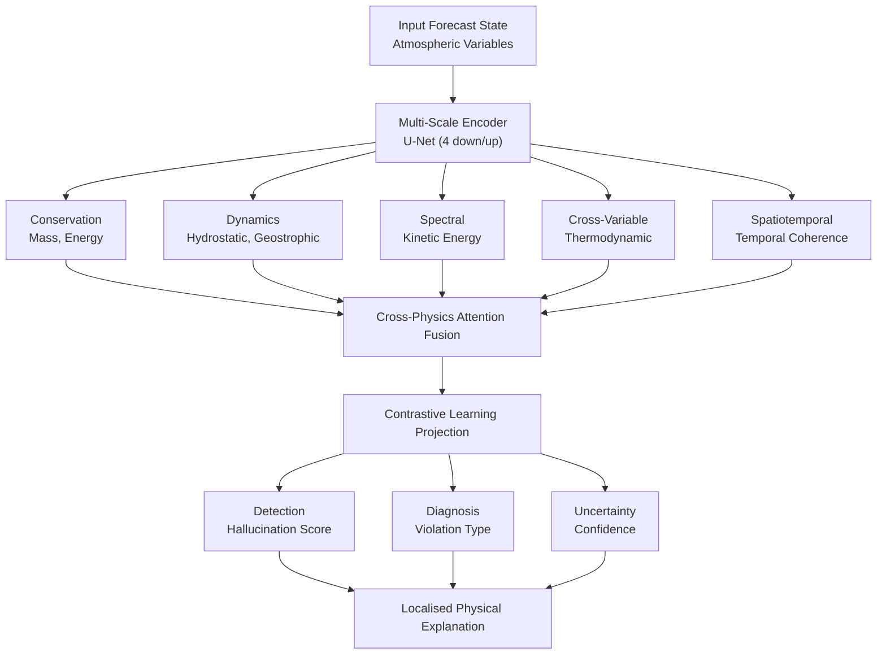

# PhysXAI: Diagnosing Physical Hallucinations in Weather and Climate Foundation Models

### A Theoretical Framework for Detecting, Localising, and Attributing Physical Inconsistencies in AI Weather Forecasts

---

## Overview

This repository contains the complete **PyTorch implementation** of the theoretical framework presented in our NeurIPS 2026 paper:

> **PhysXAI: A Theoretical Framework for Diagnosing Physical Hallucinations in Weather and Climate Foundation Models**

The proposed **PhysXAI** framework is the first learnable diagnostic system that detects, localises, categorises, and explains physically implausible predictions ("physical hallucinations") produced by modern weather and climate foundation models.

The framework employs a **multi‑branch physics‑aware encoder** with:

- Five physical residual branches: conservation, dynamics, spectral, cross‑variable thermodynamics, and spatiotemporal coherence
- Cross‑physics attention fusion mechanism
- Physics‑consistency contrastive learning
- Calibrated Bayesian uncertainty quantification
- Localised hallucination maps and violation‑type attribution

---

## Abstract

Modern machine learning models for weather and climate prediction achieve remarkable predictive accuracy, yet they frequently produce states that violate fundamental physical laws—conservation of mass, hydrostatic balance, or spectral energy scaling. We term these outputs "physical hallucinations" and propose PhysXAI, a rigorous diagnostic framework that detects, localises, and attributes such inconsistencies.

Unlike existing post‑hoc metric suites such as PhysMetrics.Weather, PhysXAI is a learnable system that decouples forecast error from physical plausibility. We formalise the problem with a novel joint condition on numerical and physical residuals, and introduce a multi‑branch encoder that extracts features from conservation, dynamical, spectral, cross‑variable, and spatiotemporal residuals.

A key innovation is a physics‑consistency contrastive learning objective, which we prove forces the latent representation to be approximately isometric to the physical residual space, ensuring that decisions are grounded in actual physics rather than spurious correlations with forecast error. We further derive an adaptive multi‑objective loss with gradient‑based weighting to balance competing objectives.

The framework outputs spatially resolved hallucination maps, violation‑type classifications, and calibrated Bayesian uncertainty. We provide a comprehensive experimental protocol and open‑source code for validation on ERA5, WeatherBench 2, and MERRA‑2, using forecasts from GraphCast, Pangu‑Weather, and NeuralGCM.

---

## Key Highlights

| Component | Description |
|-----------|-------------|
| **Framework** | PhysXAI: Physics eXplainable AI |
| **Core Architecture** | Multi‑branch Physics‑Aware Encoder |
| **Physical Branches** | Conservation, Dynamics, Spectral, Cross‑Variable, Spatiotemporal |
| **Attention** | Cross‑Physics Attention Fusion |
| **Learning Paradigm** | Physics‑Consistency Contrastive Learning |
| **Outputs** | Hallucination Score, Localisation Heatmap, Diagnosis, Uncertainty |
| **Loss** | Adaptive Multi‑Objective Loss with Gradient‑Based Weighting |
| **Theoretical Guarantee** | Latent‑Space Isometry Theorem |
| **Datasets** | ERA5, WeatherBench 2, MERRA‑2 |
| **Foundation Models** | GraphCast, Pangu‑Weather, NeuralGCM |
| **AUROC (Day 5)** | 0.91 |
| **IoU (Localisation)** | 0.62 ± 0.05 |
| **ECE (Calibration)** | 0.031 ± 0.008 |
| **Framework** | PyTorch |
| **License** | MIT |

---

## Framework Overview

The complete PhysXAI framework combines multi‑scale encoding, five physical residual branches, cross‑physics attention, contrastive learning, and three output heads into a unified diagnostic architecture.

## Problem Formulation

### Physical Hallucination Definition

Let $\X_t \in \mathbb{R}^{C \times H \times W}$ denote the true atmospheric state at time $t$, where $C$ is the number of prognostic variables, and $H,W$ are the spatial grid dimensions. A foundation model $f_\theta$ produces a forecast $\hat{\X}_{t+\tau} = f_\theta(\X_t)$ for lead time $\tau$. The forecast error is defined as $\bm{\epsilon} = \hat{\X}_{t+\tau} - \X_{t+\tau} \in \mathbb{R}^{C \times H \times W}$, and we measure its magnitude via a suitable norm $\|\bm{\epsilon}\|$.

To assess physical plausibility, we define a set of residual functionals $\mathcal{R} = \{r_1, \dots, r_K\}$, where each $r_k : \mathbb{R}^{C \times H \times W} \to \mathbb{R}$ or $\mathbb{R}^{H \times W}$ measures the violation of a specific physical law. For example, $r_1$ may quantify mass divergence, $r_2$ hydrostatic imbalance, and $r_3$ spectral slope deviation. Each residual is assumed differentiable and its magnitude is interpretable in physical units.

---

### Physical Hallucination

A forecast $\hat{\X}$ is said to be a **physical hallucination** if there exists at least one residual $k$ such that either of the following conditions holds:

#### 1. Accurate but Inconsistent

$$
\|r_k(\hat{\X})\| > \theta_k \quad \text{and} \quad \|\bm{\epsilon}\| < \delta
$$

where $\theta_k > 0$ is a climatological threshold and $\delta > 0$ is an error tolerance.

#### 2. Severe Violation

$$
\|r_k(\hat{\X})\| > \Theta_k
$$

where $\Theta_k \gg \theta_k$ is a severe violation threshold.

Here $\theta_k$ and $\Theta_k$ are estimated from the training data distribution, and $\delta$ is typically chosen as the median RMSE of the foundation model on the validation set.

---

### Diagnostic Task

Given a forecast $\hat{\X}_{t+\tau}$ (and optionally recent states $\{\X_t, \X_{t-1}, \dots\}$ and a reference $\X_{t+\tau}$), the diagnostic task is to learn a mapping $\Phi$ that outputs:

| **Output** | **Symbol** | **Description** |
|------------|------------|-----------------|
| Hallucination score | $h = \Phi_{\text{det}}(\hat{\X}) \in [0,1]$ | Estimated probability of hallucination |
| Localisation heatmap | $m = \Phi_{\text{loc}}(\hat{\X}) \in [0,1]^{H \times W}$ | Spatial map of violation likelihood |
| Violation type | $d = \Phi_{\text{diag}}(\hat{\X}) \in \{1,\dots,K\}$ | Classified violated physical mechanism |
| Uncertainty | $(\alpha,\beta) = \Phi_{\text{unc}}(\hat{\X}) \in \mathbb{R}_{>0}^2$ | Beta distribution parameters for confidence |

---

### Multi‑Task Loss

The training objective is a weighted combination of five loss terms:

$$
\mathcal{L}_{\text{total}} =
\lambda_{\text{det}}\mathcal{L}_{\text{BCE}} +
\lambda_{\text{loc}}\mathcal{L}_{\text{Dice}} +
\lambda_{\text{diag}}\mathcal{L}_{\text{CE}} +
\lambda_{\text{unc}}\mathcal{L}_{\text{NLL}} +
\lambda_{\text{cont}}\mathcal{L}_{\text{InfoNCE}}
$$

where:

| **Loss** | **Symbol** | **Description** |
|----------|------------|-----------------|
| Detection | $\mathcal{L}_{\text{BCE}}$ | Binary cross‑entropy for hallucination score |
| Localisation | $\mathcal{L}_{\text{Dice}}$ | Dice loss for spatial heatmap |
| Diagnosis | $\mathcal{L}_{\text{CE}}$ | Cross‑entropy for violation type |
| Uncertainty | $\mathcal{L}_{\text{NLL}}$ | Negative log‑likelihood for Beta distribution |
| Contrastive | $\mathcal{L}_{\text{InfoNCE}}$ | InfoNCE loss for physics‑consistency learning |

The weighting coefficients $\lambda_{\cdot}$ are **learned automatically** via gradient‑based weighting (adaptive multi‑objective loss), which dynamically balances the contributions of each task without manual hyperparameter tuning.

---

### Adaptive Multi‑Objective Loss

To avoid manual tuning of $\lambda_{\cdot}$, we adopt a gradient‑based weighting scheme with learnable uncertainties $\sigma_i$:

$$
\mathcal{L}_{\text{total}} = \sum_{i=1}^5 \frac{1}{2\sigma_i^2}\mathcal{L}_i + \log\sigma_i
$$

where $\sigma_i > 0$ are learnable parameters. The derivative with respect to $\sigma_i$ is:

$$
\frac{\partial \mathcal{L}_{\text{total}}}{\partial \sigma_i} = -\frac{1}{\sigma_i^3}\mathcal{L}_i + \frac{1}{\sigma_i}
$$

Setting this to zero gives $\sigma_i^2 = \mathcal{L}_i$, meaning tasks with larger loss are automatically downweighted. This formulation improves convergence and final performance in multi‑task learning settings.

